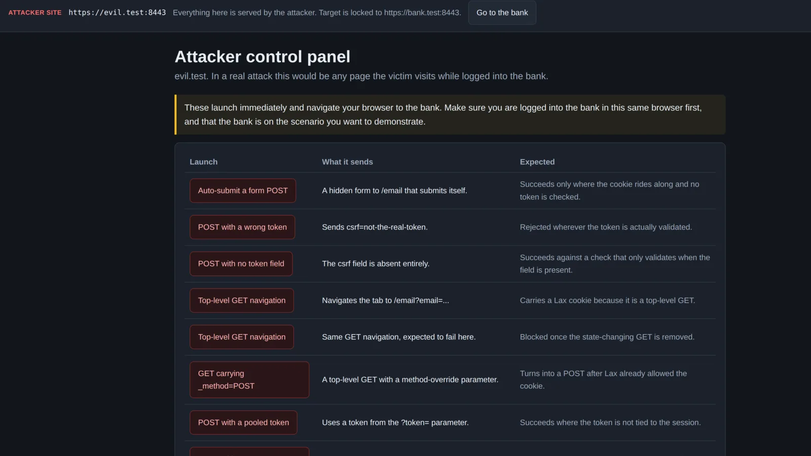
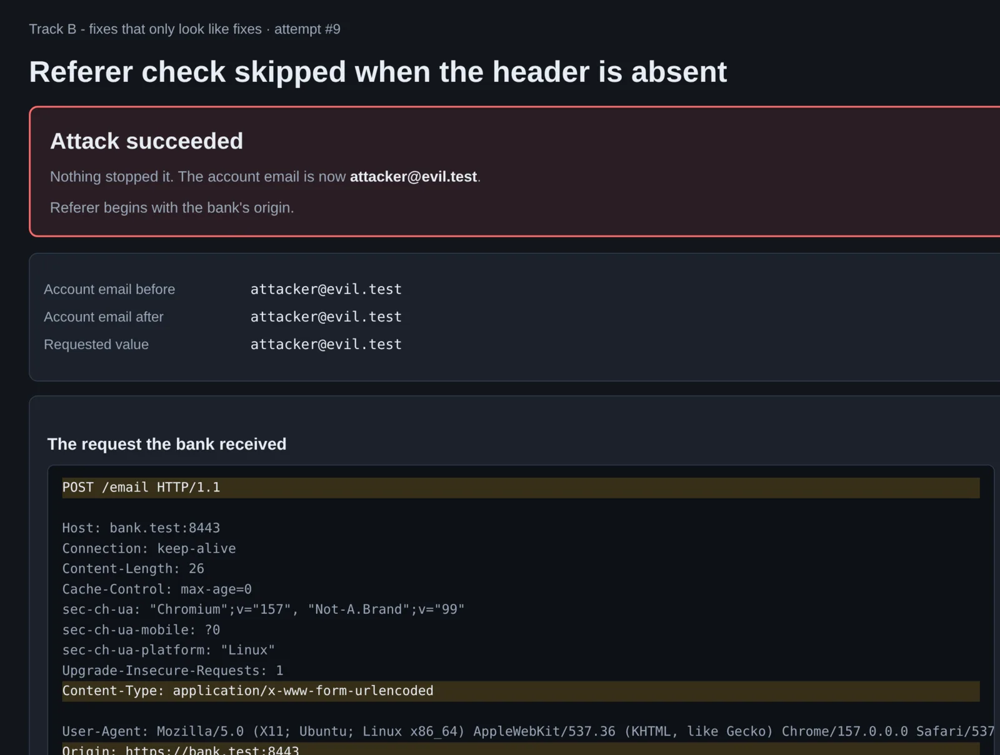
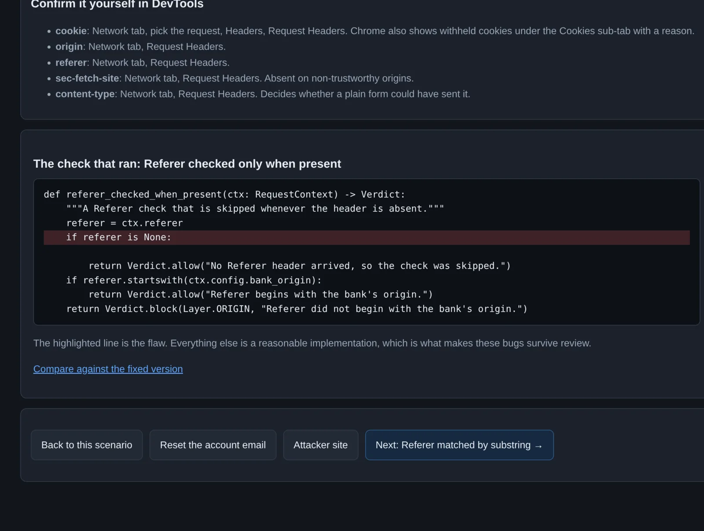
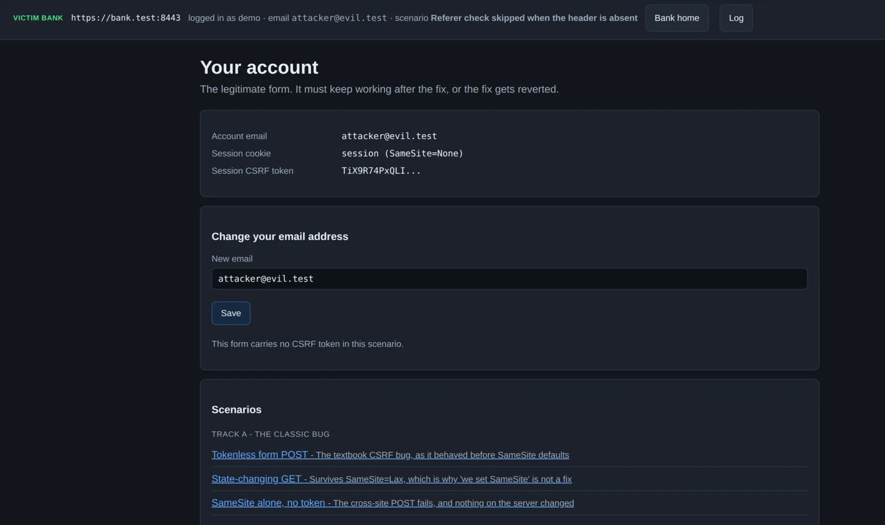

# CSRF POC lab

A pyton application to showcase CSRF attacks, based on [PortSwigger Web Security Academy CSRF labs](https://portswigger.net/web-security/csrf).

## Disclaimer

This lab is **deliberately vulnerable**: every flaw in it is the lesson not a bug to report.

It is also **vibe coded** in order to train developers on how prevent CSRF attacks, treat this lab as teaching material, not a reference for implementation. 

It binds to `127.0.0.1` only and is not something to deploy.


## What CSRF actually is

The browser attaches cookies based on where a request is going, not on who caused it. If you are
logged into the bank and then visit a page that quietly submits a form to that bank, your
browser attaches your session cookie, and the bank — seeing a valid session — performs the
action. The attacker cannot read your data, but they can make your browser *act* as you.
Authentication does not help: the forged request is fully authenticated. The server cannot tell
an intended request from a forged one unless something in the request proves intent, and a
cookie does not, because the browser sends it automatically.

Three things must all be true for the classic bug, and they double as triage against a real
endpoint:

1. **A relevant action** worth forging — changing an email, a password, a role, moving money.
2. **Cookie-based session handling**, with nothing else in the request proving intent.
3. **No unpredictable parameter** — nothing the attacker cannot guess or determine.

CSRF is usually described with cookies, but the same problem exists for any credential the
browser attaches automatically, including HTTP Basic auth and client certificates.

The scenario structure follows the [PortSwigger Web Security Academy CSRF topic](https://portswigger.net/web-security/csrf),
and the defenses follow [PortSwigger's prevention guidance](https://portswigger.net/web-security/csrf/preventing)
and the [OWASP CSRF Prevention Cheat Sheet](https://cheatsheetseries.owasp.org/cheatsheets/Cross-Site_Request_Forgery_Prevention_Cheat_Sheet.html).

## Site versus origin

SameSite and most cross-site defenses key off the **site**, which is the registrable domain
(often written eTLD+1), *not* the origin. This distinction is what the whole lab rests on.

| From | To | Same-site? | Same-origin? |
| --- | --- | --- | --- |
| `https://bank.test` | `https://bank.test` | yes | yes |
| `https://bank.test` | `https://uploads.bank.test` | **yes** | no (different host) |
| `https://bank.test` | `https://bank.test:9999` | yes | no (different port) |
| `https://bank.test` | `http://bank.test` | no (scheme differs) | no (scheme differs) |
| `https://bank.test` | `https://evil.test` | no | no |

Two consequences the lab makes concrete:

- **A cross-origin request can still be same-site.** `uploads.bank.test` is a different origin
  but the same site as `bank.test`. Anything running there — a forgotten staging box, a
  subdomain takeover, user-uploaded content — can set cookies the bank reads and issue requests
  the browser treats as same-site. This is why `SameSite=Strict` is not enough on its own.
- **Ports are irrelevant to SameSite.** This is exactly why the lab uses `bank.test` and
  `evil.test` rather than two ports on `localhost`. Two ports on one host are the same site, so
  a "protected" cookie would still be sent and the demo would show the opposite of the truth.
  `localhost` is not in the Public Suffix List — it is a reserved name (RFC 6761) that browsers
  hard-code to loopback — so `*.localhost` cross-site behavior is not reliably specified. The
  `.test` names follow the ordinary rules and behave predictably; the self-check confirms it on
  your browser.

## Why a token works

The fix that addresses the root cause is a secret the attacker cannot obtain. The server
generates an unpredictable, session-bound token, embeds it in the real form, and requires it on
every state-changing request. The attacker can force the browser to *send* a request, but the
same-origin policy stops them from *reading* the bank's pages, so they cannot learn the token.
No token, no valid request.

For that to hold, the token must be unpredictable (from a CSPRNG), tied to the user's session,
and strictly validated on every state-changing request regardless of method or content type —
with a *missing* token rejected exactly like a wrong one.

## Run it

Needs Python 3.10+, a Chromium-based browser (Chrome or Edge — Chrome is the reference for
SameSite behavior), `openssl`, and macOS or Linux.

```bash
./setup-hosts.sh          # once: maps the lab's .test names to 127.0.0.1 (prompts, needs sudo)
python3 -m csrf_lab       # serves https://bank.test:8443 with a generated self-signed cert
```

Then open **each of the three origins once** and accept the certificate warning:

- <https://bank.test:8443>
- <https://evil.test:8443>
- <https://uploads.bank.test:8443>

Chrome warns per hostname, and it **cannot show that warning inside a frame** — so if one
origin is still untrusted, the self-check probes below fail with a misleading "this site might
be temporarily down or may have moved" message instead of a certificate error. Visiting each
origin in its own tab once is the fix.

Only then open **`https://bank.test:8443/self-check`** and run the probes. It reports what
*your* browser actually does — which cookies cross the site boundary, whether `Sec-Fetch-*`
arrives, whether `Secure` cookies are accepted — and tells you plainly if the browser disagrees
with the lab's assumptions. Do this once before relying on the lab.

The lab uses reserved `.test` names so the browser treats the sites as genuinely different.
**Do not substitute two ports on `localhost`** — that is same-site, and the whole demo would
silently teach the wrong thing, because ports are irrelevant to SameSite.

| Site | URL | Role |
| --- | --- | --- |
| Bank | `https://bank.test:8443` | the victim application |
| Attacker | `https://evil.test:8443` | a different site, hosting the attacks |
| Sibling | `https://uploads.bank.test:8443` | cross-origin but same-site with the bank |

Options:

```bash
python3 -m csrf_lab --hosts=localhost   # no /etc/hosts entry, but run /self-check first
python3 -m csrf_lab --scheme=http       # no certificate; disables the SameSite=None scenarios
python3 -m csrf_lab --port=9000         # change the port
```

## What to do with it

1. **Log in** as `demo` / `demo`, and open a second tab on `https://evil.test:8443`.
2. **Open the bank's home page.** The scenarios are listed there in teaching order: Track A (the
   classic bug), Track B (fixes that only look like fixes), Track C (SameSite bypasses), then
   the fixed implementation.
3. **Work down one scenario at a time.** Each is a single screen: what it is, how the bank is
   configured, and buttons that launch the attack from `evil.test`.
4. **Read the result, not just the outcome.** After firing, you get the full HTTP request and
   response with the decisive headers highlighted, the verdict naming which layer decided, and
   the exact validation function that ran. That last part is the point — "blocked" and "blocked
   by the token" are very different findings.
5. **Reset between scenarios** with the Reset button on any result page, so the account email
   returns to normal.
6. **Ask "what if" out loud.** The [request tweaker](https://evil.test:8443/tweaker) lets you
   change the method, drop or alter the token, switch content type, or set a `Referrer-Policy`
   and fire it live.
7. **End on the centrepiece:** the "blocked for the wrong reason" scenario. Fire it with the
   cookie on `Lax` — blocked, every signal says fixed. Use the presenter toggle to switch the
   cookie to `SameSite=None`, fire the identical attack, and watch it succeed with no
   application code changed.

## What it looks like

Four screens from one pass through Track B, in Chrome, on *Referer check skipped when the header
is absent*.

<table>
<tr>
<td width="50%"></td>
<td width="50%"></td>
</tr>
<tr>
<td><b>The attacker site.</b> No exploit code — just the forged requests a page on another origin can make, and what each is expected to achieve.</td>
<td><b>The result.</b> The verdict, the account email before and after, and the request the bank actually received with the decisive headers picked out.</td>
</tr>
<tr>
<td></td>
<td></td>
</tr>
<tr>
<td><b>The check that ran.</b> Every scenario shows its own validator with the flawed line highlighted, so you read the bug instead of taking the author's word for it.</td>
<td><b>The damage.</b> The legitimate account page, now holding the attacker's address. The real form still works — a constraint any fix has to respect.</td>
</tr>
</table>

## The scenarios, and why each behaves as it does

### Track A — the classic bug

- **Tokenless form POST.** No CSRF check at all; the cookie is `SameSite=None` so it rides
  along cross-site. The forged POST changes the email. This is the baseline bug.
- **State-changing GET.** The email can be changed with a GET, and the cookie is the modern
  default `SameSite=Lax`. Lax still sends the cookie on a **top-level navigation using a safe
  method**, so a link is enough. OWASP calls a state-changing GET the single most common way
  SameSite-based defenses fail.
- **SameSite alone, no token.** With the GET route gone and a Lax cookie, the cross-site POST
  fails — the browser withholds the cookie. But the server still has no check. The protection
  lives entirely in the visitor's browser, so it does not apply to browsers that do not enforce
  SameSite and vanishes the moment someone adds a GET route or a method override.

### Track B — fixes that only look like fixes

Every scenario here ships a token and is still exploitable. These are the
[token-validation bypasses](https://portswigger.net/web-security/csrf/bypassing-token-validation)
and [Referer bypasses](https://portswigger.net/web-security/csrf/bypassing-referer-based-defenses).

- **Enforced on POST, skipped on GET.** The validation branch only runs for POST. Switch to a
  GET and the token is never examined.
- **Validated only when present.** A *wrong* token is rejected — the negative test most teams
  write — but *omitting* the parameter skips validation entirely. This is the most important one
  to internalise after adding tokens: prove your check rejects the missing case, not just the
  wrong one.
- **Not tied to the session.** The server accepts any token it ever issued. The attacker logs
  into their own account, keeps their own valid token, and sends it with the victim's cookie.
- **Tied to a non-session cookie.** The token is bound to a `csrfKey` cookie rather than the
  session. Anything that can write a cookie on the parent domain — the sibling host — controls
  both halves.
- **Naive double-submit.** The token is compared only against a cookie of the same name, with no
  server-side copy. Anything that can set the cookie can forge a matching pair. OWASP marks this
  pattern DISCOURAGED and recommends a signed, session-bound variant.
- **Referer skipped when absent.** The check is skipped when there is no Referer, and the
  attacking page suppresses the header with one meta tag. Referer is also stripped by proxies in
  normal traffic, which is why teams write the skip-if-absent branch in the first place.
- **Referer matched by substring.** The check looks for the hostname anywhere in the Referer; an
  attacker URL that merely mentions it passes. Origin comparisons must be anchored to the whole
  origin.

### Track C — SameSite bypasses

From [PortSwigger's SameSite page](https://portswigger.net/web-security/csrf/bypassing-samesite-restrictions).

- **Lax bypassed by GET** — as in Track A, and made worse when the server does not care which
  method it receives.
- **Method override.** Lax blocks the cross-site POST, so the attacker sends a top-level GET
  carrying `_method=POST`; the framework rewrites it to a POST *after* the cookie was already
  allowed. Method-override handling is common enough — `_method` in Rails, an override header in
  plenty of others — that this is a real footgun, not a curiosity.
- **Strict defeated by a same-site gadget.** With `SameSite=Strict`, a direct cross-site
  navigation carries no cookie. But a **client-side** open redirect on the sibling host turns the
  final request into an ordinary same-site request, which carries even Strict cookies. A
  server-side 302 does *not* work this way — the browser remembers the chain began cross-site.
  The lab shows both so the difference is unmistakable.

### The centrepiece — blocked for the wrong reason

An endpoint renders and validates a token and rejects the forged POST: every signal a reviewer
checks says "protected", and the ticket closes. Then the cookie flips from `Lax` to `None`,
changing no application code, and the identical attack succeeds. Two defects were hiding behind
one passing test: the token validation was broken (it skipped the missing-parameter case), and
the only thing actually stopping the attack was a cookie attribute. This is the argument for
testing each layer in isolation.

## The fixed implementation

The lab's fixed mode does all of the following, and every earlier attack fails against it:

- A CSPRNG token, stored in server-side session state, compared in constant time, with a missing
  token treated exactly like a wrong one.
- Validation on **every** state-changing request, regardless of method or content type.
- The token in a hidden field placed early in the document, never in the URL, never in a cookie.
- `Origin` compared against the full bank origin when present; otherwise an anchored `Referer`
  match, so `bank.test.evil.test` fails.
- `Sec-Fetch-Site: cross-site` rejected on unsafe methods, and its absence failing closed (OWASP
  now treats `Sec-Fetch-Site` as a primary signal; it is sent only to trustworthy origins, which
  is why the lab defaults to HTTPS).
- The session cookie `SameSite=Strict`, `HttpOnly`, `Secure`, with the `__Host-` prefix where the
  browser allows it.
- No state-changing GET exists, so a method override has nothing to reach.

Note what defense in depth buys you: even if one layer is misconfigured, another catches the
request, and the verdict line tells you which — so you never again mistake "SameSite blocked it"
for "our token works".

## What defeats CSRF defenses anyway

- **XSS.** Script running on your own origin can read the token and issue same-origin requests.
  CSRF defenses assume your origin is not already compromised. Pair them with a Content Security
  Policy and output encoding.
- **Client-side CSRF.** If your own JavaScript builds a request from attacker-controlled input (a
  URL fragment, `postMessage`, `window.name`), it will happily attach the token and the cookie
  for the attacker. The fix is input validation and not deriving request targets from untrusted
  input, not more tokens.
- **Login CSRF.** Forging the *login* request logs the victim into the attacker's account, so
  data the victim then enters lands in the attacker's account. Protect login forms too, with
  pre-session tokens.
- **Cross-site WebSocket hijacking (CSWSH).** A WebSocket handshake is a cookie-carrying request
  not covered by CORS, so do not assume a WebSocket endpoint is safe just because it needs a
  session cookie — validate the handshake's Origin.

## Questions this raises

- **"Doesn't SameSite solve this now?"** Fire *State-changing GET* again, then the centrepiece.
  Lax allows top-level GET, not every browser enforces SameSite, and sibling hosts are same-site.
- **"We send the token in a header — aren't we fine?"** Good instinct: a custom header cannot be
  set cross-site without a CORS preflight. But only if the endpoint actually *requires* the
  header. *Validated only when present* is what that looks like when it goes wrong.
- **"What about an empty token, rather than a missing one?"** They are different cases. Use the
  request tweaker to send each and watch the verdicts diverge.
- **"Can we just check Origin?"** It is a good layer, but the header can be absent, and *Referer
  matched by substring* shows how a check that looks like an origin check is not one. Anchor the
  comparison to the whole origin.

## Review checklist

- Two genuinely different sites, not two ports on one host. Ports are irrelevant to SameSite.
- A forged POST with no token returns 400 and changes nothing. **Then omit the parameter
  entirely**, not just send a wrong value.
- Replay another account's token against your session — it must be rejected.
- Test each layer in isolation. Disable `SameSite` and confirm the token alone still blocks the
  attack, so you know which defense is actually load-bearing.
- Confirm no state-changing GET exists, and that a method-override header cannot resurrect one.
- In DevTools, confirm the auth cookie's `SameSite` value and that a cross-site POST carries no
  cookie.
- Confirm the legitimate form still works with the token the page rendered — a defense that
  breaks the real form gets reverted.
- For one-off proofs against a real app, Burp Suite Pro's "Generate CSRF PoC" builds the forged
  HTML for you.

## Troubleshooting

- **`bank.test` does not resolve / connection refused.** The `/etc/hosts` entry is missing. Run
  `./setup-hosts.sh`, or use `--hosts=localhost`.
- **Certificate warning in the browser.** Expected: self-signed cert. Accept it once per
  hostname — all three origins, not just the bank. To avoid it entirely, use
  `--scheme=http --hosts=localhost` and read the capability warnings the lab prints — some
  scenarios go inert.
- **The self-check probe frames say a site "might be temporarily down or may have moved".**
  That is an unaccepted certificate warning for `evil.test` or `uploads.bank.test`: Chrome
  refuses to render the interstitial *inside* a frame, so it looks like a dead site. Open that
  origin in its own tab, accept, then reload `/self-check`.
- **A "fixed" attack appears to succeed, or a blocked one succeeds intermittently.** Almost
  always stale cookies from a previous scenario. Clear cookies for the lab hosts, or use a fresh
  private window, and log in again. Chrome's two-minute "Lax+POST" exception only applies to
  cookies with no SameSite attribute; the lab always sets one explicitly to avoid it.
- **Safari or Firefox behave differently from Chrome.** Run `/self-check` and believe what it
  reports. If a browser treats the two hosts as same-site, use `--hosts=test`.
- **Port already in use.** Pass `--port=9000` (or any free port).
- **Removing the host entries.** `./setup-hosts.sh --undo`.

> **Threat boundary.** It binds to `127.0.0.1` only, the attacker page can target only the
> bundled bank origin, and the redirect gadget and cookie-setter are constrained to the lab's own
> origins. Do not deploy it or expose it to a network.

